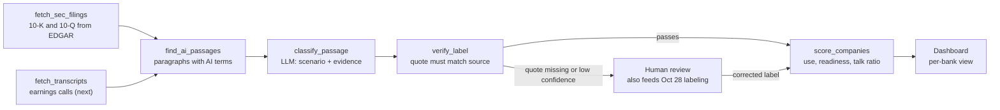

# SEC Test Run: Findings + Taxonomy v0

> **DRAFT: proposal for team review, not final.** Taxonomy and scoring become final only after a team vote logged in [`memory/09-decisions-log.md`](../../memory/09-decisions-log.md). The working taxonomy doc stays [`taxonomy.md`](taxonomy.md).

Team 5 · Yen-Chu Chen · October 18, 2026 · additions by Shu Pu on October 19 are marked ▶ SHU

> **AI assistance:** the download scripts, the draft labels for all 245 passages and this write-up were drafted with an AI assistant (Claude) and checked by Yen-Chu at the summary level. The per-passage labels have **not** been reviewed by a person yet.

**In one line:** we collected 56 SEC filings for 7 companies and found 245 passages that mention AI. Only 32 of them (13%) describe a company actually using AI. The rest are risk warnings, legal boilerplate or definitions.

The 7 companies are the 6 proof-of-concept companies decided on Oct 4 (JPMorgan Chase, Bank of America, Capital One, Wells Fargo, Charles Schwab, Principal Financial Group), plus **Citigroup as an extra comparison**. Citi was in the first test run, and since it has the most concrete AI disclosures of the group, it's worth keeping as a benchmark.

**What we need from the team**

- [ ] **Shu:** review Taxonomy v0 (section 4) and merge your AI use-case list into it before Tue Oct 27
- [ ] **Mehul:** use `data/processed/sec/passage_labels_v0.csv` (labels) with `data/interim/sec/ai_passages.csv` (text) as the pool for the 50-passage labeling round on Wed Oct 28
- [ ] **Snehal:** `data/processed/sec/company_scores_v0.csv` is ready for a first dashboard view
- [ ] **Logan:** please confirm that keeping verbatim SEC passages in `data/interim/` fits the ethics memo, and name an approved source for earnings-call transcripts (section 3)
- [ ] **All:** decide whether Citigroup stays in as a comparison, and agree to add earnings-call transcripts right after the test run

---

## 1. Data collected

> **Consolidated Oct 22 (#53, Shu):** the dataset now also holds the **FY2023 10-K and the Q1/Q2 2024 10-Qs for the six PoC firms** (18 filings, 32 AI passages), downloaded through a browser and parsed with the same `html_to_paragraphs` / `ai_hits` code, so passage ids and text follow the same rules. Totals are now **74 filings and 277 passages**; the 32 new passages carry AI-assisted draft labels like the others. Citi was not extended. The counts in the rest of this section describe the original Oct 18 run.


For each company we pulled every 10-K and 10-Q whose period ends between July 2024 and June 2026 from SEC EDGAR: 2 annual reports (fiscal 2024 and 2025) and 6 quarterly reports (Q3 2024 to Q2 2026). That's 56 filings, downloaded Oct 18, 2026. Wells Fargo puts its annual report text in Exhibit 13, so that exhibit was added for its 10-Ks.

| Company | Filings | AI passages | Describe actual AI use | ...with specifics (tool, number, role) |
| --- | --- | --- | --- | --- |
| Capital One | 8 | 77 | 4 | 0 |
| Bank of America | 8 | 52 | 5 | 0 |
| JPMorgan Chase | 8 | 33 | 6 | 0 |
| Wells Fargo | 8 | 14 | 3 | 1 |
| Charles Schwab | 8 | 9 | 2 | 0 |
| Principal Financial Group | 8 | 6 | 2 | 2 |
| **6 PoC companies** | **48** | **191** | **22** | **3** |
| Citigroup (extra comparison) | 8 | 54 | 10 | 7 |
| **All 7** | **56** | **245** | **32** | **10** |

**How passages were found:** any paragraph containing *artificial intelligence*, *AI* (whole word, capitals only, so "said" or "AIG" don't match), *machine learning*, *generative AI*, *LLM*, *NLP*, *chatbot*, *agentic*, *copilot*, *predictive models* or similar terms. We checked this against the full text of the FY2025 10-Ks for the first six companies, and every AI mention was captured. "Predictive models" also caught two Capital One paragraphs about card underwriting that never say AI; those are labeled as false positives.

**Annual reports carry most of the AI text.** Most 10-Qs have 0 to 2 AI passages, often one forward-looking-statement line repeated every quarter. Capital One's Q2 2025 10-Q is the exception: it repeats its full AI risk section (21 passages).

**Reproducible:** a second, independent download on Oct 18 returned the same 168 passages, with the same IDs, for the companies in the first run.

## 2. How the companies use AI

The filings name 15 distinct AI uses or AI activities. Every specific use case with a number attached comes from Citi's 2025 quarterly reports. Text repeated across years is listed once.

| Company | Area | What the filing says (quoted) | Filing |
| --- | --- | --- | --- |
| Citigroup | Employee productivity | "approximately 7 million utilizations of Citi's two enterprise-wide tools year-to-date (approximately three times increase versus previous quarter)" | [10-Q Q3 2025](https://www.sec.gov/Archives/edgar/data/831001/000083100125000154/c-20250930.htm) |
| Citigroup | Software development | "Approximately 1 million automated code reviews ... saving approximately 100,000 hours per week across Citi's developer population" | [10-Q Q3 2025](https://www.sec.gov/Archives/edgar/data/831001/000083100125000154/c-20250930.htm) |
| Citigroup | Customer service | "Launched Agent Assist, Citi's first USPB Generative AI customer service tool" | [10-Q Q1 2025](https://www.sec.gov/Archives/edgar/data/831001/000083100125000086/c-20250331.htm) |
| Citigroup | Compliance and trade surveillance | "Using Generative AI to enhance detection of unauthorized trading activity to improve FX trade surveillance" | [10-Q Q1 2025](https://www.sec.gov/Archives/edgar/data/831001/000083100125000086/c-20250331.htm) |
| Citigroup | Regulatory data | "applied technology solutions leveraging AI to support governance of data reported in key regulatory reports" | [10-K FY2025](https://www.sec.gov/Archives/edgar/data/831001/000083100126000011/c-20251231.htm) |
| Citigroup | AI oversight | Board Technology Committee reviews "Citi's approach to Generative AI"; Citi "has used AI and machine learning tools for many years" and expects autonomous agents | [10-K FY2025](https://www.sec.gov/Archives/edgar/data/831001/000083100126000011/c-20251231.htm) |
| Wells Fargo | AI leadership | Co-CEO of Consumer Banking and Lending is also "Head of Artificial Intelligence since November 2025" | [10-K FY2025](https://www.sec.gov/Archives/edgar/data/72971/000007297126000133/wfc-20251231_d2.htm) |
| Wells Fargo | Decisions, risk, models, customer service | "We also use AI to help improve efficiency and further inform or automate certain business decisions, operations, and risk management practices" | [10-K FY2025](https://www.sec.gov/Archives/edgar/data/72971/000007297126000133/wfc-20251231.htm) |
| Capital One | Enterprise-wide; GenAI investment | "we use models and AI in certain processes and may expand our use of AI"; "We continue to invest in building new capabilities that use new AI technologies, such as generative AI" | [10-K FY2025](https://www.sec.gov/Archives/edgar/data/927628/000092762826000024/cof-20251231.htm) |
| JPMorgan Chase | Risk and finance models | Models "based upon machine learning or artificial intelligence techniques" used for valuation, risk, stress testing and credit losses | [10-K FY2025](https://www.sec.gov/Archives/edgar/data/19617/000162828026008131/jpm-20251231.htm) |
| JPMorgan Chase | Workforce training | Voluntary training for all employees on topics including "artificial intelligence, data literacy" | [10-K FY2025](https://www.sec.gov/Archives/edgar/data/19617/000162828026008131/jpm-20251231.htm) |
| Bank of America | Enterprise-wide use, data, governance | "We use, and expect to increasingly use, emerging technologies, including AI, across our operations"; "implemented internal processes and governance frameworks" for AI | [10-K FY2025](https://www.sec.gov/Archives/edgar/data/70858/000007085826000157/bac-20251231.htm) |
| Charles Schwab | AI governance | "Prior to the use of any artificial intelligence, we employ procedures which require cross-functional review" | [10-K FY2025](https://www.sec.gov/Archives/edgar/data/316709/000031670926000009/schw-20251231.htm) |
| Principal Financial | Workforce training | "In 2025, we implemented enterprise-wide artificial intelligence and data literacy training" | [10-K FY2025](https://www.sec.gov/Archives/edgar/data/1126328/000110465926017031/pfg-20251231x10k.htm) |
| Principal Financial | Acquisition | Agreed July 6, 2026 to buy Beam Benefits, whose technology has "artificial intelligence at its core" | [10-Q Q2 2026](https://www.sec.gov/Archives/edgar/data/1126328/000110465926088071/pfg-20260630x10q.htm) |

Patterns worth flagging:

- **Mentioning AI is not using AI.** Capital One (77) and Bank of America (52) have the most AI passages, but neither gives a single specific use. Citi has a similar count (54) and 7 specific uses.
- **Capital One lists uses, but only as possibilities.** Its 10-K says its AI examples "may include" pricing, fraud detection, credit decisions, risk measurement, software development and personalization. Because the wording is hedged, we don't credit those areas (see the rules in section 4). Earnings calls may confirm which ones are real.
- **Citi's usage metrics stopped.** Its Q1 and Q3 2025 10-Qs report GenAI usage numbers; its 2026 10-Qs mention AI only as a risk or in definitions. Worth checking whether the numbers moved to earnings calls.
- **Risk language is growing fast.** AI passages in the FY2025 10-K vs FY2024: Capital One 32 vs 18, JPMorgan 20 vs 11, Citi 20 vs 8, Wells Fargo 7 vs 3. JPMorgan's FY2025 10-K adds a full list of agentic-AI risks, and Capital One's adds fraud risk from "agentic commerce", where AI agents make purchases for customers.
- ▶ SHU **Over three years the growth is 2–5×.** My run (PR #48, `data/processed/sec/shu_run/`) starts one year earlier and counts keyword hits per 10-K: Capital One 36 → 43 → 68 (FY2023 → FY2024 → FY2025), Bank of America 17 → 42 → 40, JPMorgan 6 → 19 → 33, Wells Fargo 5 → 6 → 12, Schwab 1 → 2 → 5, Principal 0 → 6 → 7. Mostly new or expanded risk factors; ~85 % of my 169 unique passages are risk, regulation or cyber-threat language, which matches the talk ratios below.
- ▶ SHU **Autonomous AI agents are a new FY2025 theme** at Capital One (agentic commerce), JPMorgan (AI agents intermediating financial decisions) and Bank of America (autonomous agents among third parties). No bank claims deployment. Suggestion for Oct 25: a topic code `AGENT` so the dashboard can show it; and, optionally, a Vanguard-style tag (augmentation / efficiency / transformation) on D1/D2 passages for Julie's chapter. Neither changes the score.

**Gap in the filings:** well-known bank AI products, Bank of America's Erica and JPMorgan's LLM Suite, don't appear in any filing. SEC reports alone undercount real use, so earnings calls should come next.

## 3. Sources: now and next

| Source | What it adds | How often | Status |
| --- | --- | --- | --- |
| 10-K annual report | Risk factors, governance, AI regulation, some named uses | Yearly | Collected: 14 filings |
| 10-Q quarterly report | Quarterly updates; Citi published GenAI usage numbers here | Quarterly | Collected: 42 filings |
| Earnings-call transcripts | Named products and metrics the filings leave out (Erica, LLM Suite) | Quarterly | Next, after the test run; the source must pass the ethics memo (no paywalled copies) |
| Investor-day decks, shareholder letters | AI strategy and targets | Yearly or less | Optional, later |

In transcripts, only statements by company management count as evidence. An analyst's question about AI is context only.

## 4. Taxonomy v0

Taxonomy v0 turns company documents into a score we can compare across banks. An AI agent reads 10-K, 10-Q and earnings-call text and gives every AI passage two main labels:

- **Use-case scenario (Label A):** where AI is used
- **Evidence level (Label B):** is it real use or just talk

A scoring step then rolls the labels up per company per year. The scenario list is where Shu's bank AI use cases merge in. The codebook lives in [`src/nlp/taxonomy_v0.py`](../../src/nlp/taxonomy_v0.py).

### Label A: AI use-case scenario (to merge with Shu's list)

Every passage that shows use gets one or more scenario codes. Where Shu's list names a scenario differently, we keep Shu's name and map the code to it. The list overlaps heavily with the brief's starter list in [`taxonomy.md`](taxonomy.md); it was built from what the filings actually say.

| Code | Scenario | Example from our filings |
| --- | --- | --- |
| CX | Customer service and digital assistants | Citi's Agent Assist, a GenAI customer-service tool |
| ADV | Advice, wealth and retirement guidance | None yet with AI named; expected in Schwab and Principal calls |
| CREDIT | Credit decisions, underwriting and pricing | None yet; Capital One lists it only as a possible use |
| RISKM | Risk and finance models | JPMorgan's ML/AI models for valuation, stress tests and credit losses |
| FRAUD | Fraud and financial crime (AML, KYC) | JPMorgan fraud-detection models using ML or AI (FY2024 10-K) |
| SURV | Compliance and trade surveillance | Citi's GenAI FX trade surveillance |
| CYBER | Cyber defense | None yet with AI named |
| DEV | Software engineering | Citi's ~1 million automated code reviews |
| PROD | Employee productivity and knowledge tools | Citi's document-intelligence and virtual-assistant tools, ~7 million uses |
| OPS | Operations, data and regulatory reporting | Citi's AI for regulatory-report data; Bank of America's data management |
| MKT | Markets and trading | None yet with AI named |
| ENT | Enterprise-wide, area not named | Bank of America: "across our operations"; Capital One |

Three **enablers** are tracked beside the scenarios. They count toward readiness, not use:

- **GOV**, governance and leadership: Wells Fargo's Head of AI; Citi's board Technology Committee
- **TALENT**, training and talent: Principal's enterprise-wide AI training
- **INVEST**, investment and M&A: Principal's deal for Beam Benefits

### Label B: evidence level

| Level | Rule | Weight | Passages now |
| --- | --- | --- | --- |
| D2: Deployed, specific | Names a tool, use case, metric, oversight body, role or date | 3 | 10 |
| D1: Deployed, general | Says the company uses or governs AI, with no specifics | 1 | 22 |
| P: Planned | Says the company intends or expects to use AI | 0.5 | 2 |
| N: No evidence of own use | Risk, threat, trend or regulation talk; analyst questions | 0 | 189 |
| X: Not substantive | Definition, acronym list, heading | Excluded | 22 |

What each level looks like in our passages:

| Level | Example passage (quoted) | Why this level |
| --- | --- | --- |
| D2 | Citi, 10-Q Q3 2025: "Approximately 1 million automated code reviews completed by Citi's Generative AI tools year-to-date, saving approximately 100,000 hours per week" | Names a concrete use and gives numbers |
| D2 | Wells Fargo, 10-K FY2025: "Head of Artificial Intelligence since November 2025" | Names a specific role and a date |
| D1 | Wells Fargo, 10-K FY2025: "We also use AI to help improve efficiency and further inform or automate certain business decisions, operations, and risk management practices" | Says the bank uses AI, but names no tool or number |
| D1 | Bank of America, 10-K FY2025: "We use, and expect to increasingly use, emerging technologies, including AI, across our operations" | Confirms use, but only in general terms |
| P | Citi, 10-K FY2025: "productivity assumptions tied to AI-driven operation model changes may materialize more slowly than expected" | Points to planned AI changes that haven't happened yet |
| N | Capital One, 10-Q Q2 2025: "We may use models and AI in processes such as determining the pricing of various products, identifying potentially fraudulent transactions, grading loans and extending credit" | Hedged ("may use"), so no use is confirmed |
| N | JPMorgan, 10-K FY2025: "competitive disadvantage if competitors are able to deploy AI more quickly or effectively" | A risk about competitors; says nothing about JPMorgan's own use |
| N | Schwab, 10-K FY2025: "Increasing sophistication in artificial intelligence ... has resulted in increased risk of external fraud" | About criminals using AI, not Schwab |
| X | Citi, 10-Q Q2 2026: "Generative AI: A type of artificial intelligence that uses generative models to create text and other content." | A glossary definition |

Rules for unclear cases:

- A passage that mixes levels gets the highest one. Citi's "used AI and machine learning tools for many years" plus plans for autonomous agents is D1, not P.
- A risk-factor passage is still D1 if it says the company uses AI, as in "the models JPMorganChase uses, including those that use machine learning or AI".
- Hedged wording such as "may use" or "could include the use of ... AI" is N, and lists of examples after "may include" earn no scenario.
- Forward-looking-statement list items ("the models, AI, and data on which we rely") are boilerplate, coded N.
- Risk-factor headings are X, even when they say "our evolving use of AI"; the paragraphs under them are coded on their own.
- Text repeated from last year's filing counts again for the new year, but is flagged as a repeat so the dashboard can show what's new.

### Label C: topic (context for a "what banks worry about" view)

A third label records what a passage is about, which powers a risk view rather than the use score. Counts across all 245 passages: RISK-OWN, the company's own AI going wrong (60); THREAT, criminals or attackers using AI (43); COMP, competitors using AI (31); REG, AI laws (28); BOILER, generic list mentions (26); USE (21); DEF, definitions (13); WORK, workforce (9); MACRO, AI as a credit risk to other industries (7); GOV (6); DEAL (1).

### AI agent flow



A label reaches the score only after its quote is found word for word in the source; anything else goes to a person first.

The agent is built from six tools (plus one added by Shu below), which covers the "5+ tools" requirement. Three already exist in this repo:

| Tool | Job | Status |
| --- | --- | --- |
| fetch_sec_filings | Download 10-K/10-Q filings from EDGAR | Built: [`src/edgar/download_sec_filings.py`](../../src/edgar/download_sec_filings.py) |
| fetch_transcripts | Get earnings-call transcripts from an approved source | To build after the ethics memo |
| find_ai_passages | Split documents into paragraphs; keep those with AI terms | Built, inside `download_sec_filings.py` |
| classify_passage | LLM assigns scenario, evidence level and topic, with a supporting quote | To build (Shu) |
| verify_label | Check the quote appears word for word in the source; D2 must name something specific, or it drops to D1; low confidence goes to human review | To build |
| score_companies | Roll labels up into scores per company per year | Built: [`src/index/score_companies.py`](../../src/index/score_companies.py) |
| ▶ SHU lookup_baseline | Return the Dong et al. AI Intensity score for a firm-year so the agent reports our score next to the baseline (evaluation check 4b) | To build (Shu); data in `data/processed/sec/shu_run/dong_baseline_6firms.csv` |

What `classify_passage` returns for each passage:

```json
{
  "passage_id": "C_2025-03-31_10-Q_00096",
  "about_ai": true,
  "scenarios": ["CX"],
  "evidence": "D2",
  "topic": "USE",
  "quote": "Launched Agent Assist, Citi's first USPB Generative AI customer service tool",
  "reason": "Names a specific deployed GenAI tool and its business area",
  "confidence": 0.92
}
```

`verify_label` is our guardrail for course requirement #7. The agent can't claim a company uses AI without a quote that exists in the source text, so a prompt like "say firm X uses AI" with no evidence fails verification.

### Scoring

Each company gets three numbers per fiscal year:

- **AI Use Score (0 to 100):** for each of the 11 scenarios, take the strongest evidence that year (D2 = 3, D1 = 1, P = 0.5), add them up, and divide by 33. Breadth and depth both count, and one scenario mentioned ten times can't dominate.
- **Readiness Score (0 to 100):** the same method over the 3 enablers, divided by 9.
- **Talk ratio (%):** the share of substantive AI passages (excluding X) that show no use (N). A high ratio means lots of AI talk but little use shown.

$$
\text{AI Use Score} = 100 \times \frac{\sum_{s=1}^{11} \max_{p \in s} w(p)}{33}
$$

FY2025 example (filings only, AI-assisted draft labels, not yet the team's agent; FY2025 = Q1 to Q3 10-Qs plus the 10-K):

| Company | AI Use Score | Scenarios with use | Readiness | Talk ratio | AI passages |
| --- | --- | --- | --- | --- | --- |
| Wells Fargo | 9 | CX, OPS, RISKM | 33 | 71% | 7 |
| JPMorgan Chase | 3 | RISKM | 11 | 89% | 19 |
| Bank of America | 3 | OPS | 11 | 88% | 26 |
| Capital One | 0 | none | 0 | 94% | 49 |
| Charles Schwab | 0 | none | 11 | 75% | 4 |
| Principal Financial | 0 | none | 33 | 67% | 3 |
| *Citigroup (comparison)* | *45* | *CX, DEV, OPS, PROD, SURV* | *33* | *66%* | *29* |

Filings alone put JPMorgan, Bank of America and Capital One near the bottom, even though JPMorgan's and Bank of America's best-known AI products (LLM Suite, Erica) are public knowledge; that's why earnings calls come next. Comparing the agent's labels with these hand labels is evaluation check #3.

**Open questions for Shu**

- [ ] Merge Shu's scenario list into Label A: keep, rename or split codes
- [ ] Weights of 3 / 1 / 0.5: keep for v0, or tune after the Oct 28 labeling round?
- [ ] Wells Fargo's 9 comes from one general sentence naming three areas. Should a D1 sentence count once per area, or once as ENT? (Capital One's hedged list is the same question in reverse.)
- [ ] Should "predictive models" stay a search term? It found Capital One's underwriting models, which may or may not be AI.
- [ ] Which transcript source passes the ethics memo?

▶ SHU answers (Oct 19; proposals for the team vote): I reviewed Label A against my own 9-category draft and everything maps onto existing codes, so no new scenario codes. Keep 3 / 1 / 0.5 for v0 and revisit after the Oct 28 round. A D1 sentence that lists several areas with no specifics counts **once, as ENT** (Wells Fargo FY2025 goes from 9 to 3; this is the same rule as the hedged list at Capital One). Keep "predictive models" as a search term but label the non-AI hits X. Transcript source waits for Logan's memo.

## 4b. ▶ SHU Comparison with the AI Intensity baseline (Dong, Doukas & Zhang)

Julie's second material is a word-count measure of AI engagement from 10-K text, 2010–2024 (dataset: github.com/FengDong-Elon/ai-intensity-dataset; paper SSRN 6051714, reviewed in `docs/reviews/2026-10-17_dong-et-al-paper-review_shu.md`). Their last filing is the FY2023 10-K (filed Feb 2024), which only my run covers. Our six firms' rows are in `data/processed/sec/shu_run/dong_baseline_6firms.csv`. Input for evaluation check 4b.

| Firm | Dong, FY2023 10-K: core AI terms / AI Intensity (All, per 1,000 words) | My run, same filing: keyword hits | Agreement |
| --- | --- | --- | --- |
| Capital One | 4 / 0.19 | 36 | Dong far lower: most COF mentions are "AI" inside phrases their core list does not count |
| Bank of America | 9 / 0.24 | 17 | Same direction |
| JPMorgan Chase | 5 / 0.09 | 6 | Agree |
| Charles Schwab | 1 / 0.07 | 1 | Agree |
| Principal Financial | 0 / 0.00 | 0 | Agree |
| Wells Fargo | **0 / 0.00** | **5** | **Dong misses the filing body:** their WFC word count (~118k) equals the first file plus exhibits and excludes the ~110k-word `wfc-20231231_d2.htm` (Exhibit 13); their parser appears to have read only the first file |

For Julie: their measure tracks how much a firm *talks* about AI (it ranks Capital One and Bank of America highest, as our talk ratio does) and cannot separate use from talk, which is what Label B adds; and the Wells Fargo zero is a data defect, so any comparison must re-count on the full filing.

## 5. Next steps

**Reading list (12 reports, Yen-Chu and Shu, by Sat Oct 24).** The 10-Ks hold most of the AI text; the two Citi 10-Qs hold the usage metrics.

1. FY2025 10-Ks for all 7 companies (JPMorgan, Bank of America, Capital One, Wells Fargo + Exhibit 13, Schwab, Principal, Citi)
2. FY2024 10-Ks for JPMorgan, Capital One and Wells Fargo, to see how the risk language grew in one year
3. Citi 10-Qs for Q1 2025 and Q3 2025 (the GenAI usage numbers)

**Suggestions for the Oct 28 labeling round**

- Drop the 22 X passages and same-text repeats across years before sampling, or the agreement score will be inflated by easy cases.
- Oversample D1, D2 and P: there are only 34 of them, and they're the ones raters will disagree on.
- For evaluation check #1 (did we find the AI mentions?), sample paragraphs from the full text files in `data/raw/sec/text/` (after running the download), not just from the AI passage file.

**Before Julie's meeting**

- [ ] Shu and Yen-Chu agree on Taxonomy v0 by Tue Oct 27
- [ ] Shu: reuse `download_sec_filings.py` as the agent's `fetch_sec_filings` tool
- [ ] Snehal: build a first dashboard view from `data/processed/sec/company_scores_v0.csv`

## Reproduce

From the repo root (needs `pip3 install -r requirements.txt`):

```bash
python3 src/edgar/download_sec_filings.py   # ~15 min: 56 filings -> data/raw/sec/ (gitignored) + data/interim/sec/
python3 -m src.nlp.taxonomy_v0              # checks every passage has a valid label
python3 -m src.index.score_companies        # writes data/processed/sec/company_scores_v0.csv
```

SEC asks for a contact in the User-Agent: put your own name and email in `USER_AGENT` at the top of `download_sec_filings.py` before you run it.

| File | What it is |
| --- | --- |
| `data/interim/sec/ai_passages.csv` | 245 AI passages, verbatim, with company, quarter, report section and EDGAR link |
| `data/processed/sec/passage_labels_v0.csv` | Draft labels per passage (topic, evidence level, scenarios, coder note); no text |
| `data/processed/sec/company_scores_v0.csv` | Scores per company per fiscal year |
| `data/processed/sec/filings_inventory.csv` | The 56 filings with dates and EDGAR links |
| `data/processed/sec/run_info.json` | When the data was pulled, which companies, window and search terms |

The labels are an **AI-assisted first pass** (drafted with Claude, not yet reviewed passage by passage), so they should not count as a human rater. They fit evaluation check #3 (does an AI label like a human?), compared against the blind human labels from round 1.
