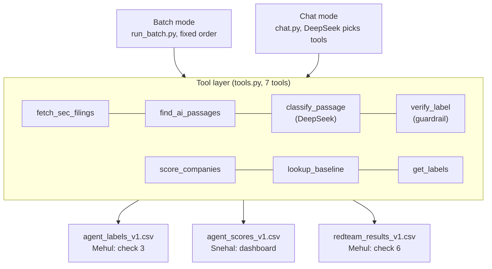
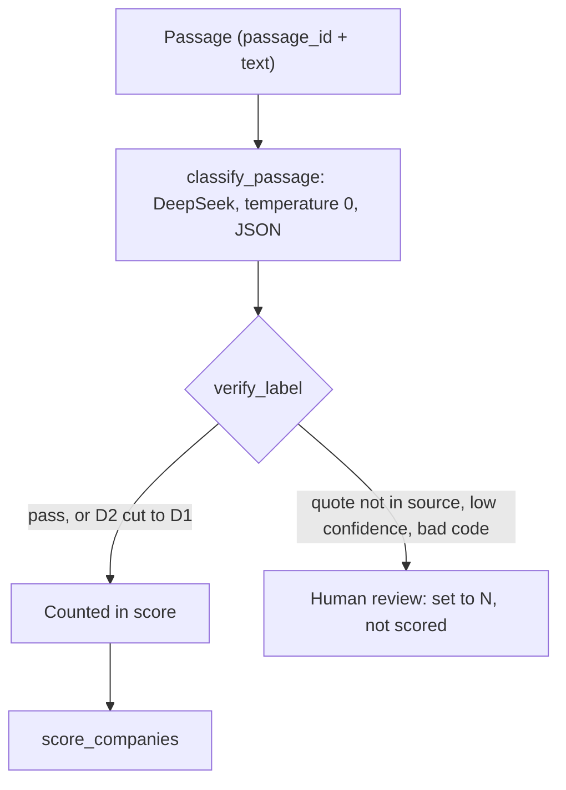

# AI agent design (v1)

> **Owner:** Shu Pu · **Issues:** #28 (design, due Fri Oct 23), #35 (first working agent, due Wed Oct 28) · **Code:** [`src/agent/`](../../src/agent/) · **Status:** connected to DeepSeek; first real run on the 90 FY2025 10-K passages done Oct 23 ([results](first_run_results.md)), then prompt tuning to classify-v1.2 ([notes](prompt_tuning_v1.2.md)).

## What the agent does
It reads AI passages from SEC filings, decides whether the filing company **uses** AI or only **talks** about it (Taxonomy v0, [`sec_test_run_taxonomy_v0_DRAFT.md`](../part2-taxonomy/sec_test_run_taxonomy_v0_DRAFT.md)), checks every label with a rule-based guardrail, and rolls the labels up into company scores. One LLM call per passage; everything else is plain code.

## Architecture


**Batch mode** labels all passages in a fixed order and writes the files the team uses. **Chat mode** is the agentic part (course requirement #3 and the TP3 "plans and acts across steps" criterion): DeepSeek reads the tool descriptions, decides which tools to call, and answers with cited quotes. Both modes share the same tools, so chat answers and dashboard numbers agree.

## One passage through batch mode


## Granularity and data contract
| Level | Unit | Key | Source |
|---|---|---|---|
| Label | one passage | `passage_id` (`<TICKER>_<period>_<form>_<idx>`) | `data/interim/sec/ai_passages.csv` (Yen-Chu's SEC run, 245 passages) |
| Score | company x fiscal year | `ticker`, `fiscal_year` = year of `period` | same rule as `score_companies.py` |
| Evaluation | one passage | `passage_id` | `irr.py` joins on it |

**`data/processed/sec/agent_labels_v1.csv`**: the first 11 columns are identical to `passage_labels_v0.csv`, so `irr.py` and `score_companies.py` read it unchanged (both now take an optional path: `--ai-labels`, `--labels`; defaults unchanged). Extra columns: `quote, specific, confidence, flags, evidence_raw, scenarios_raw, verify_status, verify_reason, model, prompt_version, run_at`.
`evidence_v0` / `scenarios_v0` hold the value **after** the guardrail. Rows in `needs_review` are written as N with no scenario so they never reach the score; the model's own call stays in `evidence_raw` / `scenarios_raw`.

**`data/processed/sec/agent_scores_v1.csv`**: same columns as `company_scores_v0.csv`, so the dashboard (#37) only swaps the file name.

## The seven tools
Each tool has a docstring written for the LLM and a JSON schema in `TOOL_SPECS`. Tools return `{"error": ...}` instead of raising, so the agent can recover.

| # | Tool | Input | Output | LLM? | Code |
|---|---|---|---|---|---|
| 1 | `fetch_sec_filings` | ticker, fiscal_year, forms, live | filings with period, accession, URL, AI passage count | no | wraps Yen-Chu's `download_sec_filings.py` (local inventory; `live=True` hits EDGAR, disabled in chat) |
| 2 | `find_ai_passages` | ticker, fiscal_year, forms, limit | passages with id, section, text, SEC link | no | reads Yen-Chu's passage file |
| 3 | `classify_passage` | passage_id (or text), requested_company | evidence, scenarios, topic, quote, specific, reason, confidence, flags | **DeepSeek** | new |
| 4 | `verify_label` | label, source_text | label after checks + verify_status, verify_reason | no | new (guardrail) |
| 5 | `score_companies` | labels (agent/draft), tickers, fiscal_year | AI Use, Readiness, talk ratio per firm-year | no | wraps Yen-Chu's `score_companies.score()` |
| 6 | `lookup_baseline` | ticker, fiscal_year | Dong et al. AI Intensity (core, all), availability note | no | new; FY2023 and earlier; WFC flagged |
| 7 | `get_labels` | ticker, fiscal_year, evidence, scenario | stored labels with verified quotes and links | no | new; chat starts here |

`classify_passage` returns the JSON format Yen-Chu specified, plus `specific` (the named tool, number, body, role or date behind a D2) and `flags` (`injection_attempt`, `company_mismatch`, `not_a_company_statement`).

## Guardrails (course requirement #7, evaluation check 6)
Principle: **rather miss a real use than claim one the filing does not support** (overclaim target ≤ 5%).

| Layer | Rule | If it fails |
|---|---|---|
| `verify_label` | D2/D1/P quote must appear word for word in the passage (typography normalised; `...` allowed between fragments, in order) | needs_review, not scored |
| `verify_label` | D2 `specific` must be non-generic and inside the quote | D2 → D1 |
| `verify_label` | confidence ≥ 0.70 | needs_review |
| `verify_label` | codes must exist in the codebook; D2/D1/P need a scenario; N/X carry none | review / scenarios removed |
| `verify_label` | model flagged `company_mismatch` but claimed use | needs_review |
| Prompt | passage wrapped in `<passage>` tags; instructions inside it are data, flagged as `injection_attempt` | — |
| Chat prompt | cite passage_id + verified quote for every use claim; public SEC data only; no paywalled or copyrighted text; no investment advice; never reveal keys | — |
| Dispatcher | in chat, `classify_passage` output always goes through `verify_label` (the model cannot skip it); live EDGAR off | — |

`--no-guardrails` turns all of these off (plain prompt, no verification) so `redteam.py` can show the difference. `verify_label` is pure code and unit-tested against RT08, RT09, RT14 and RT18.

## Model
| Setting | Value | Why |
|---|---|---|
| Provider / model | DeepSeek `deepseek-flash`, snapshot DeepSeek-V4.1-Flash-1017 (team decision Oct 18; checked Oct 23 against `GET /models` and DeepSeek's pricing and change-log pages) | cheap, JSON mode, function calling (both tested Oct 23) |
| Pinning caveat | `deepseek-flash` is an alias: DeepSeek points it at its newest Flash snapshot (-1017 as of Oct 23), and the API offers no way to request an older one. Each label records the model tag and the cache keeps old answers, but a fresh run after a DeepSeek update may use a newer snapshot. Check the change log before a rerun. | — |
| Thinking mode | On by default for this model. Its reasoning tokens count toward `max_tokens` and are billed as output | — |
| Temperature | 0 | as stable as the API allows |
| Output | `response_format: json_object`, schema in the prompt | fixed format |
| Reproducibility | on-disk cache keyed by model + prompt version + messages | temperature 0 is not a determinism guarantee; reruns read the cache |
| Few-shot | six made-up passages (two added in classify-v1.2) | real ones could leak labeling-sample answers into check 3 |
| Prompt version | `classify-v1.2` (Oct 23; [tuning notes](prompt_tuning_v1.2.md)) | bump `PROMPT_VERSION` on every prompt change so the cache doesn't reuse old answers |

**Cost estimate (for #55):** about 1.7k prompt tokens per passage (1.5k fixed system prompt and examples, which DeepSeek caches, plus ~200 for the passage) and ~150 output tokens. 245 passages ≈ 0.42M input + 37k output tokens; at the listed off-peak prices ($0.15/M input on a cache miss, $0.003/M on a hit, $0.60/M output) one full run costs about $0.05, and the whole project, including prompt tuning and chat, should stay under $5. Prices confirmed on DeepSeek's own pricing page on Oct 23 (per 1M tokens, off-peak / peak: input cache hit $0.003 / $0.006, cache miss $0.15 / $0.30, output $0.60 / $1.20; peak is 01:00–04:00 and 06:00–10:00 UTC on weekdays). The real cost of the first run is in [first_run_results.md](first_run_results.md).

**Responsible AI:** only public SEC filing text is sent to DeepSeek's servers (no transcripts, personal data or keys). The key lives in `.env` (gitignored). Every label records the model snapshot and prompt version. DeepSeek processes prompts on servers in China; this is acceptable for public filings but not for any restricted source.

## How to run
```bash
pip3 install -r requirements.txt
cp .env.example .env            # add DEEPSEEK_API_KEY=...
python3 -m src.agent.run_batch --tickers JPM,BAC,COF,WFC,SCHW,PFG --year 2025 --forms 10-K   # Oct 28 target: 90 passages
python3 -m src.agent.run_batch                                   # all 245 passages
python3 -m src.agent.run_batch --ids docs/part3-metrics/labeling_round_1/sample_passages.csv --labels-out data/processed/sec/agent_labels_sample.csv
python3 -m src.eval.irr --ai-labels data/processed/sec/agent_labels_v1.csv                   # check 3
python3 -m src.agent.chat --trace "How does JPMorgan use AI in FY2025, and how does that compare with Dong?"
python3 -m src.agent.redteam                                     # check 6, writes data/processed/agent/redteam_results_v1.csv
AGENT_LLM_PROVIDER=mock python3 -m src.agent.run_batch --limit 20   # offline dry run, no key
python3 -m unittest discover -s tests -t .                       # 19 tests
```

## Status and open items
- **Done:** all seven tools, prompts, DeepSeek client (retries, cache, JSON), batch, chat loop, red-team runner, 19 offline tests. A mock dry run on the 90 FY2025 10-K passages reproduces the v0 draft scores, which confirms the file contract end to end.
- **Done Oct 23:** first real DeepSeek run on the 90 passages, compared with the draft labels ([first_run_results.md](first_run_results.md)).
- **Done Oct 23:** prompt tuning to classify-v1.2: overclaim 6.7% → 2.2% against the draft labels ([notes](prompt_tuning_v1.2.md)).
- **Next:** rerun with the final codebook after Oct 27; then the 50-passage sample for check 3 and the red-team run for check 6 (with Mehul, ~Nov 3).
- **#33 (pending):** whether ENT counts toward the AI Use Score. `--ent-counts` switches it on; default off (current behaviour).
- **Red-team note for Mehul:** RT20 expects "P; no scenario", but the codebook requires a scenario on every P label (`check_labels`), so the agent will return P + CREDIT. Suggest updating RT20's expected value.
- **Codebook changes:** when Taxonomy v0 is finalised (Oct 27), bump `PROMPT_VERSION` in `config.py` so the cache does not reuse old answers.
